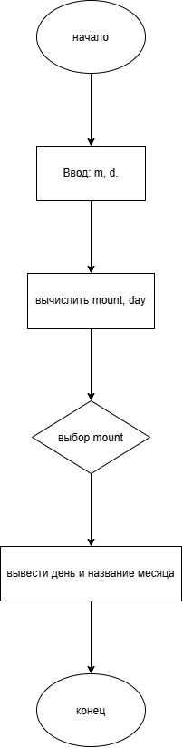

# Домашнее задание к работе 7

## Условие задачи

С января 2000 года по некоторый день прошло n месяцев и 3 дня. Определить название месяца этого дня. Предусмотреть возможность задания другого числа дней.
---

## 1. Алгоритм и блок-схема

### Алгоритм

1. Объявить переменную `m`, `d`, `month`, `day` типа int.
2. Запросить у пользователя месяц и количество дней (`m`, `d`).
3. Рассчитать сколько прошло месяцев и дней: `month = (m % 12) + 1`, `day = d + 1`.
4. Вывести месяц и день.
5. Завершить программу.

## Блок-схема

---

## 2. Реализация программы
---

## 3. Результаты работы программы

Пример работы программы при 5 месяцев и 6 дней:
---

Введите количество месяцев: 5
Введите количество дней: 7
8 июня

---

## 4. Информация о разработчике

- **ФИО:** Губский Данил Максимович
- **Группа:** бОТИ-261
